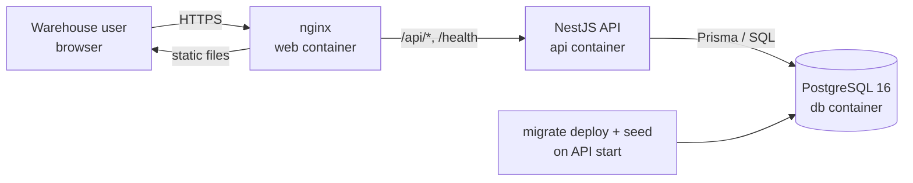
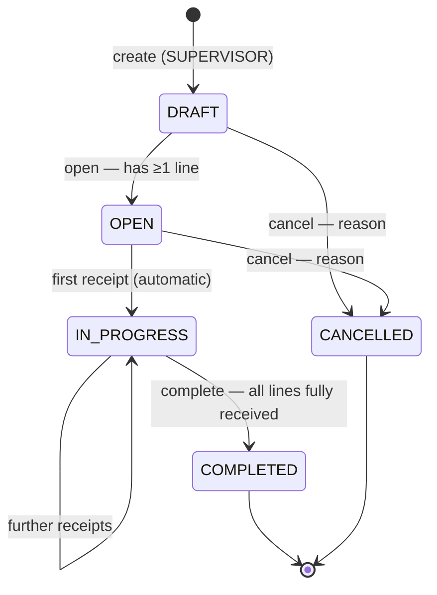

# Technical Specification — Warehouse Receiving System (WRS)

| Field | Value |
|---|---|
| Version | 1.0 |
| Derived from | [prd.md](prd.md) v1.0 |
| API contract | [openapi.yaml](openapi.yaml) (source of truth for request/response shapes) |
| Diagrams | [erd.mmd](erd.mmd), [data-flow.mmd](data-flow.mmd), [receipt-sequence.mmd](receipt-sequence.mmd), [document-states.mmd](document-states.mmd) |
| Implementation plan | [tasks.md](tasks.md) |

> **Rule for implementers (human or AI):** this document decides *how*; the PRD decides *what*. If the two disagree, stop and flag it. If something is not specified here, choose the simplest option that satisfies the PRD and record it in `docs/ai-workflow.md` under "Decisions made during implementation".

---

## 0. Technology stack

| Layer | Choice | Version (pin major) | Notes |
|---|---|---|---|
| Runtime | Node.js | 22 LTS | Same version in Docker and locally |
| Language | TypeScript | 5.x | `strict: true` in both apps |
| Backend framework | NestJS | 11.x | Modules, guards, pipes, exception filters |
| ORM / migrations | Prisma | 6.x | `prisma migrate` for versioned SQL migrations; raw SQL for row locks and CHECK constraints |
| Database | PostgreSQL | 16 | |
| Validation | class-validator + class-transformer | latest | Global `ValidationPipe` with `whitelist`, `forbidNonWhitelisted`, `transform` |
| Auth | @nestjs/jwt + passport-jwt, bcrypt | latest | HS256 access token, no refresh token |
| API docs | `docs/openapi.yaml` (hand-written, contract-first) | OpenAPI 3.1 | Served read-only at `/api/docs` via Swagger UI |
| Backend tests | Jest + Supertest | latest | Integration tests run against a real PostgreSQL test database |
| Frontend | React 19 + Vite + TypeScript | latest | |
| UI kit | Mantine 8 | latest | Tables, forms, notifications |
| Data fetching | TanStack Query 5 | latest | Cache + invalidation after mutations |
| Routing | React Router 7 | latest | |
| Frontend tests | Vitest + Testing Library; Playwright for E2E | latest | |
| Containers | Docker, Docker Compose v2 | | nginx serves the built frontend |

## 1. System architecture

### 1.1 Components

| Component | Responsibility | Talks to |
|---|---|---|
| **Web client** (`frontend/`) | Pages for login, products, receiving documents, receiving, inventory, transactions. Holds the JWT in `sessionStorage`. Generates idempotency keys for receipts. Performs convenience validation only. | API over HTTP/JSON (`/api/v1/*`) |
| **nginx** (`web` container) | Serves the static frontend build. Reverse-proxies `/api/` and `/health` to the API so the browser sees one origin (no CORS). | API container |
| **API** (`backend/`) | Authentication, authorization, validation, business rules, transactions, error mapping. Stateless. | PostgreSQL via Prisma |
| **PostgreSQL** (`db` container) | Persistent storage; enforces uniqueness, foreign keys and CHECK constraints as a second line of defence. | — |
| **Migrator** (runs inside the API container on start) | Applies pending Prisma migrations (`prisma migrate deploy`), then optionally seeds. | PostgreSQL |



### 1.2 Backend module structure

```
backend/src/
  main.ts                      # bootstrap, global pipes/filters, /api/v1 prefix
  app.module.ts
  config/                      # typed env config, validated at startup (fail fast)
  prisma/                      # PrismaService (single client)
  common/
    errors/                    # AppError, error codes enum, global exception filter
    auth/                      # JwtAuthGuard, RolesGuard, @Roles(), @CurrentUser()
    pagination/                # PageQueryDto, paginate() helper
  modules/
    auth/                      # POST /auth/login, GET /auth/me
    products/                  # list, get, create
    receiving/                 # documents, lines, transitions, receipts
      receiving-documents.controller.ts
      receiving-documents.service.ts
      receipts.service.ts      # the critical transaction (§6)
      document-state.ts        # pure state machine (§7), unit-tested
    inventory/                 # balances + transactions (read only)
    health/                    # GET /health
backend/prisma/
  schema.prisma
  migrations/                  # generated SQL + hand-added CHECK constraints
  seed.ts                      # idempotent upserts
backend/test/                  # integration + API tests (Supertest)
```

**Layering rule:** controllers only parse/validate input and call one service method. Services own business rules and transactions. No business rule lives only in a controller or only in the frontend.

### 1.3 Frontend structure

```
frontend/src/
  api/          # fetch client (adds token, maps error envelope), typed endpoint functions
  auth/         # AuthProvider, ProtectedRoute, useCurrentUser, role helpers
  pages/        # LoginPage, ProductsPage, DocumentsPage, DocumentCreatePage,
                # DocumentDetailPage, InventoryPage, TransactionsPage
  components/   # StatusBadge, QuantityInput, ReceiveForm, ErrorAlert, Pagination
  main.tsx, App.tsx (routes)
```

Routes: `/login`, `/products`, `/receiving` (list), `/receiving/new`, `/receiving/:id`, `/inventory`, `/inventory/transactions`. Default route after login: `/receiving`.

## 2. Entity relationship diagram

Full diagram: [erd.mmd](erd.mmd).

| Entity | PK | Key relationships | Important constraints |
|---|---|---|---|
| `users` | `id` uuid | referenced by documents, receipts, transactions | `username` unique |
| `products` | `id` uuid | 1–1 `inventory_balances`; 1–N `receiving_items`, `inventory_transactions` | `sku` unique, upper-case format check |
| `receiving_documents` | `id` uuid | 1–N `receiving_items`; N–1 `users` (created/opened/completed/cancelled by) | `document_number` unique; status enum |
| `receiving_items` | `id` uuid | N–1 document (cascade delete only matters for drafts), N–1 product (restrict) | `unique(document_id, product_id)`; `expected > 0`; `0 ≤ received ≤ expected` |
| `receipts` | `id` uuid | N–1 item, N–1 user; 1–1 inventory transaction | `idempotency_key` unique; `quantity > 0` |
| `inventory_balances` | `product_id` (PK & FK) | 1–1 product | `quantity_on_hand ≥ 0` |
| `inventory_transactions` | `id` bigint identity | N–1 product, user, document; 1–1 receipt | `receipt_id` unique; `quantity_change <> 0`; `balance_after ≥ 0` |

**Why both a balance table and a ledger?** `inventory_balances` gives a fast, lockable current figure for listing and for the row lock in §6. `inventory_transactions` is the append-only audit trail that explains every figure. BR-12 (balance = sum of ledger) is checked by an automated reconciliation test.

**Why `bigint` for transaction IDs?** The ledger needs a strict insertion order for "newest first" and for tie-breaking when two rows share a timestamp.

## 3. Database design

### 3.1 Conventions

- Table and column names are `snake_case`; Prisma models are `PascalCase` with `@@map`/`@map`.
- IDs are UUIDs generated by the database (`gen_random_uuid()`), except the ledger.
- All timestamps are `timestamptz`, stored in UTC.
- Quantities are `integer`.
- No soft deletes; no hard deletes except draft lines.

### 3.2 DDL (authoritative; the Prisma migration must produce exactly this)

```sql
CREATE EXTENSION IF NOT EXISTS pgcrypto;

CREATE TYPE user_role AS ENUM ('OPERATOR', 'SUPERVISOR');
CREATE TYPE receiving_status AS ENUM ('DRAFT', 'OPEN', 'IN_PROGRESS', 'COMPLETED', 'CANCELLED');
CREATE TYPE inventory_transaction_type AS ENUM ('RECEIPT');

CREATE TABLE users (
  id             uuid PRIMARY KEY DEFAULT gen_random_uuid(),
  username       varchar(50)  NOT NULL UNIQUE,
  password_hash  varchar(100) NOT NULL,
  full_name      varchar(100) NOT NULL,
  role           user_role    NOT NULL,
  created_at     timestamptz  NOT NULL DEFAULT now()
);

CREATE TABLE products (
  id               uuid PRIMARY KEY DEFAULT gen_random_uuid(),
  sku              varchar(50)   NOT NULL UNIQUE,
  name             varchar(200)  NOT NULL,
  unit_of_measure  varchar(20)   NOT NULL,
  description      varchar(1000),
  created_at       timestamptz   NOT NULL DEFAULT now(),
  updated_at       timestamptz   NOT NULL DEFAULT now(),
  CONSTRAINT products_sku_format_chk CHECK (sku ~ '^[A-Z0-9][A-Z0-9-]{2,49}$')
);
CREATE INDEX products_name_idx ON products (lower(name));
CREATE INDEX products_created_at_idx ON products (created_at DESC);

CREATE SEQUENCE receiving_document_number_seq START 1;

CREATE TABLE receiving_documents (
  id                uuid PRIMARY KEY DEFAULT gen_random_uuid(),
  document_number   varchar(20)       NOT NULL UNIQUE,
  supplier_name     varchar(200)      NOT NULL,
  reference_number  varchar(100),
  expected_date     date,
  notes             varchar(1000),
  status            receiving_status  NOT NULL DEFAULT 'DRAFT',
  created_by_id     uuid NOT NULL REFERENCES users(id),
  opened_at         timestamptz,
  opened_by_id      uuid REFERENCES users(id),
  completed_at      timestamptz,
  completed_by_id   uuid REFERENCES users(id),
  cancelled_at      timestamptz,
  cancelled_by_id   uuid REFERENCES users(id),
  cancel_reason     varchar(500),
  created_at        timestamptz NOT NULL DEFAULT now(),
  updated_at        timestamptz NOT NULL DEFAULT now(),
  CONSTRAINT rd_cancel_reason_chk CHECK (
    (status = 'CANCELLED') = (cancel_reason IS NOT NULL AND cancelled_at IS NOT NULL)
  ),
  CONSTRAINT rd_completed_chk CHECK (
    (status = 'COMPLETED') = (completed_at IS NOT NULL)
  )
);
CREATE INDEX rd_status_created_idx ON receiving_documents (status, created_at DESC);
CREATE INDEX rd_created_at_idx ON receiving_documents (created_at DESC);
CREATE INDEX rd_supplier_idx ON receiving_documents (lower(supplier_name));

CREATE TABLE receiving_items (
  id                     uuid PRIMARY KEY DEFAULT gen_random_uuid(),
  receiving_document_id  uuid    NOT NULL REFERENCES receiving_documents(id) ON DELETE CASCADE,
  product_id             uuid    NOT NULL REFERENCES products(id) ON DELETE RESTRICT,
  expected_quantity      integer NOT NULL,
  received_quantity      integer NOT NULL DEFAULT 0,
  created_at             timestamptz NOT NULL DEFAULT now(),
  updated_at             timestamptz NOT NULL DEFAULT now(),
  CONSTRAINT ri_document_product_uq UNIQUE (receiving_document_id, product_id),
  CONSTRAINT ri_expected_positive_chk CHECK (expected_quantity BETWEEN 1 AND 1000000),
  CONSTRAINT ri_received_range_chk CHECK (received_quantity >= 0 AND received_quantity <= expected_quantity)
);
CREATE INDEX ri_product_idx ON receiving_items (product_id);

CREATE TABLE receipts (
  id                 uuid PRIMARY KEY DEFAULT gen_random_uuid(),
  receiving_item_id  uuid         NOT NULL REFERENCES receiving_items(id) ON DELETE RESTRICT,
  quantity           integer      NOT NULL,
  idempotency_key    varchar(100) NOT NULL UNIQUE,
  received_by_id     uuid         NOT NULL REFERENCES users(id),
  received_at        timestamptz  NOT NULL DEFAULT now(),
  CONSTRAINT receipts_quantity_positive_chk CHECK (quantity > 0)
);
CREATE INDEX receipts_item_idx ON receipts (receiving_item_id, received_at);

CREATE TABLE inventory_balances (
  product_id        uuid PRIMARY KEY REFERENCES products(id) ON DELETE RESTRICT,
  quantity_on_hand  integer     NOT NULL DEFAULT 0,
  updated_at        timestamptz NOT NULL DEFAULT now(),
  CONSTRAINT ib_non_negative_chk CHECK (quantity_on_hand >= 0)
);

CREATE TABLE inventory_transactions (
  id                     bigint GENERATED ALWAYS AS IDENTITY PRIMARY KEY,
  product_id             uuid    NOT NULL REFERENCES products(id) ON DELETE RESTRICT,
  type                   inventory_transaction_type NOT NULL,
  quantity_change        integer NOT NULL,
  balance_after          integer NOT NULL,
  receipt_id             uuid UNIQUE REFERENCES receipts(id) ON DELETE RESTRICT,
  receiving_document_id  uuid REFERENCES receiving_documents(id) ON DELETE RESTRICT,
  created_by_id          uuid NOT NULL REFERENCES users(id),
  created_at             timestamptz NOT NULL DEFAULT now(),
  CONSTRAINT it_change_nonzero_chk CHECK (quantity_change <> 0),
  CONSTRAINT it_balance_non_negative_chk CHECK (balance_after >= 0),
  CONSTRAINT it_receipt_link_chk CHECK (type <> 'RECEIPT' OR (receipt_id IS NOT NULL AND receiving_document_id IS NOT NULL AND quantity_change > 0))
);
CREATE INDEX it_product_created_idx ON inventory_transactions (product_id, id DESC);
CREATE INDEX it_document_idx ON inventory_transactions (receiving_document_id);
CREATE INDEX it_created_at_idx ON inventory_transactions (created_at DESC);
```

### 3.3 Migration strategy

1. Define models in `backend/prisma/schema.prisma` matching §3.2 (enums, `@unique`, `@@unique`, `@@index`, `@db.VarChar(n)`, `@db.Timestamptz`, `@db.Date`).
2. Generate the initial migration with `prisma migrate dev --name init --create-only`.
3. **Hand-edit** the generated `migration.sql` to append what Prisma cannot express: all `CHECK` constraints, the `lower(...)` expression indexes, the `receiving_document_number_seq` sequence, and `CREATE EXTENSION pgcrypto`. Then apply it.
4. Every later schema change is a new migration folder; applied migrations are never edited.
5. Production/container start runs `prisma migrate deploy` (applies pending migrations only, never resets, safe to run repeatedly).
6. Seeding (`prisma/seed.ts`) uses upserts keyed on `username` and `sku`, so it can run on every start without duplicating data. It runs only when `SEED_ON_START=true`.
7. Tests use a separate database (`DATABASE_URL` pointing at `wrs_test`); the Jest global setup runs `prisma migrate reset --force --skip-seed` once, and each test file truncates tables in `beforeEach`.

### 3.4 Seed data

| What | Values |
|---|---|
| Users | `supervisor` (SUPERVISOR, "Siti Supervisor"), `operator` (OPERATOR, "Budi Operator"). Passwords from `SEED_SUPERVISOR_PASSWORD` / `SEED_OPERATOR_PASSWORD`; seed fails if they are unset. |
| Products | 5 demo cold-storage products, e.g. `FRZ-CHK-001` Frozen Chicken Breast 1kg (CTN), `FRZ-FSH-002` Frozen Tuna Loin (CTN), `CHL-DRY-003` UHT Milk 1L (CTN), `FRZ-VEG-004` Frozen Mixed Vegetables 500g (PCS), `CHL-MEA-005` Beef Sirloin Chilled (PCS), each with balance 0. |

## 4. API contract

Full contract: [openapi.yaml](openapi.yaml). Base path `/api/v1`. JSON only. Field names are `camelCase`.

### 4.1 Endpoint summary

| Method | Path | Roles | Success | Purpose |
|---|---|---|---|---|
| POST | `/auth/login` | public | 200 | Exchange credentials for a token |
| GET | `/auth/me` | any | 200 | Current user |
| GET | `/products` | any | 200 | List/search products |
| POST | `/products` | SUPERVISOR | 201 | Create product (+ balance 0) |
| GET | `/products/{productId}` | any | 200 | Product detail with on-hand |
| GET | `/receiving-documents` | any | 200 | List/filter documents |
| POST | `/receiving-documents` | SUPERVISOR | 201 | Create draft (optionally with lines) |
| GET | `/receiving-documents/{documentId}` | any | 200 | Detail with lines and receipts |
| POST | `/receiving-documents/{documentId}/items` | SUPERVISOR | 201 | Add line (DRAFT) |
| PATCH | `/receiving-documents/{documentId}/items/{itemId}` | SUPERVISOR | 200 | Change expected qty (DRAFT) |
| DELETE | `/receiving-documents/{documentId}/items/{itemId}` | SUPERVISOR | 204 | Remove line (DRAFT) |
| POST | `/receiving-documents/{documentId}/open` | SUPERVISOR | 200 | DRAFT → OPEN |
| POST | `/receiving-documents/{documentId}/complete` | SUPERVISOR | 200 | IN_PROGRESS → COMPLETED |
| POST | `/receiving-documents/{documentId}/cancel` | SUPERVISOR | 200 | DRAFT/OPEN → CANCELLED |
| POST | `/receiving-documents/{documentId}/items/{itemId}/receipts` | OPERATOR, SUPERVISOR | 201 (200 on replay) | Record a receipt |
| GET | `/inventory` | any | 200 | Current balances |
| GET | `/inventory/transactions` | any | 200 | Ledger with filters |
| GET | `/health` (no `/api/v1` prefix) | public | 200 / 503 | Readiness |

Transitions are `POST` actions on sub-resources rather than `PATCH status`, so each transition has its own guard, its own role check and its own error codes, and an invalid status cannot be "patched in".

### 4.2 Error envelope

Every non-2xx response has this body:

```json
{
  "error": {
    "code": "QUANTITY_EXCEEDS_REMAINING",
    "message": "Cannot receive 61 units; only 60 remaining for FRZ-CHK-001.",
    "details": { "remainingQuantity": 60, "requestedQuantity": 61 }
  }
}
```

For `VALIDATION_ERROR`, `details` is `{ "fields": [ { "field": "sku", "message": "..." } ] }`.

### 4.3 Status code policy

| Status | When | Codes |
|---|---|---|
| 400 | Request is malformed or fails field validation (type, range, format, missing header) | `VALIDATION_ERROR` |
| 401 | Missing/invalid/expired token; wrong login | `UNAUTHENTICATED`, `INVALID_CREDENTIALS` |
| 403 | Authenticated but role not allowed | `FORBIDDEN` |
| 404 | Resource in the path does not exist (or item does not belong to document) | `NOT_FOUND` |
| 409 | Request conflicts with current state | `DUPLICATE_SKU`, `DUPLICATE_PRODUCT_IN_DOCUMENT`, `INVALID_DOCUMENT_STATUS`, `INVALID_STATUS_TRANSITION`, `IDEMPOTENCY_KEY_REUSED` |
| 422 | Input is well-formed and state is right, but a business rule rejects it | `QUANTITY_EXCEEDS_REMAINING`, `DOCUMENT_HAS_NO_ITEMS`, `ITEMS_NOT_FULLY_RECEIVED`, `PRODUCT_NOT_FOUND` |
| 500 | Unexpected error (logged with stack; message is generic) | `INTERNAL_ERROR` |
| 503 | Health check: database unreachable | — |

Prisma errors are mapped in the global exception filter: `P2002` on `products.sku` → `DUPLICATE_SKU`; on `ri_document_product_uq` → `DUPLICATE_PRODUCT_IN_DOCUMENT`; `P2025` → `NOT_FOUND`. A PostgreSQL CHECK violation (`23514`) that reaches the filter is a bug in service logic; it is mapped to 500 and logged, never silently accepted.

### 4.4 Pagination and filtering

Query params `page` (≥1, default 1) and `pageSize` (1–100, default 20). Response:

```json
{ "data": [ ... ], "meta": { "page": 1, "pageSize": 20, "totalItems": 57, "totalPages": 3 } }
```

## 5. Data flow

Diagrams: [data-flow.mmd](data-flow.mmd) (context data flow), [receipt-sequence.mmd](receipt-sequence.mmd) (§6 as a sequence diagram), [document-states.mmd](document-states.mmd) (§7).

| Flow | Path |
|---|---|
| Login | LoginPage → `POST /auth/login` → AuthService (bcrypt compare) → JWT signed with `JWT_SECRET` → stored in `sessionStorage` → sent as `Authorization: Bearer` on every request |
| Read lists | Page → TanStack Query → `GET` → service → Prisma query with `skip/take` + count → `{data, meta}` |
| Create product | Form → `POST /products` → ValidationPipe → ProductsService: transaction { insert product, insert balance(0) } → 201 |
| Draft document | Create page → `POST /receiving-documents` (with lines) → transaction { nextval sequence → number, insert document, insert lines } → 201 → redirect to detail |
| Receive | ReceiveForm → `POST .../receipts` + `Idempotency-Key` → ReceiptsService transaction (§6) → 201 → frontend invalidates document, inventory and transactions queries |
| Inventory | `inventory_balances` joined with `products`; ledger from `inventory_transactions` joined with product, document, user |

The only writes to `inventory_balances` and `inventory_transactions` happen inside `ReceiptsService.recordReceipt` (and the balance insert when a product is created). No other code path may change stock.

## 6. API flow — recording a receipt (critical path)

`POST /api/v1/receiving-documents/{documentId}/items/{itemId}/receipts`
Headers: `Authorization: Bearer <jwt>`, `Idempotency-Key: <uuid generated by client>`
Body: `{ "quantity": 40 }`

| Step | Layer | Action | Failure |
|---|---|---|---|
| 1 | JwtAuthGuard | Verify token | 401 `UNAUTHENTICATED` |
| 2 | RolesGuard | Role ∈ {OPERATOR, SUPERVISOR} | 403 `FORBIDDEN` |
| 3 | ValidationPipe / controller | `documentId`, `itemId` are UUIDs; `quantity` is integer 1–1,000,000; `Idempotency-Key` present, 8–100 chars, `[A-Za-z0-9_-]` | 400 `VALIDATION_ERROR` |
| 4 | ReceiptsService | **Begin transaction** (`prisma.$transaction(async tx => …)`, isolation READ COMMITTED, timeout 10 s) | |
| 5 | | Look up receipt by idempotency key. If found: if same `itemId` and `quantity` → **commit, return 200** with the original result and header `Idempotent-Replayed: true`; else → 409 `IDEMPOTENCY_KEY_REUSED` | 409 |
| 6 | | `SELECT … FROM receiving_documents WHERE id = $1 FOR UPDATE` | 404 `NOT_FOUND` |
| 7 | | Status must be `OPEN` or `IN_PROGRESS` | 409 `INVALID_DOCUMENT_STATUS` |
| 8 | | `SELECT … FROM receiving_items WHERE id = $2 AND receiving_document_id = $1 FOR UPDATE` | 404 `NOT_FOUND` |
| 9 | | `remaining = expected_quantity − received_quantity`; if `quantity > remaining` | 422 `QUANTITY_EXCEEDS_REMAINING` (details: remaining, requested) |
| 10 | | `INSERT INTO receipts (…)` | unique violation on key → see step 15 |
| 11 | | `UPDATE receiving_items SET received_quantity = received_quantity + $q, updated_at = now()` | |
| 12 | | `UPDATE inventory_balances SET quantity_on_hand = quantity_on_hand + $q, updated_at = now() WHERE product_id = $p RETURNING quantity_on_hand` (the UPDATE takes the row lock) | |
| 13 | | `INSERT INTO inventory_transactions (type 'RECEIPT', quantity_change $q, balance_after <returned>, receipt_id, receiving_document_id, created_by_id)` | |
| 14 | | If document status is `OPEN` → set `IN_PROGRESS`, `updated_at = now()` | |
| 15 | | **Commit.** If the insert in step 10 raised a unique violation on `idempotency_key` (two identical requests raced), the transaction is rolled back and the service re-runs step 5 once, outside the failed transaction, returning the replay or 409. | |
| 16 | Controller | 201 with `ReceiptResult`: `{ receipt, item (with remainingQuantity, isFullyReceived), document: { id, documentNumber, status, allItemsReceived }, inventory: { productId, quantityOnHand } }` | |

**Concurrency reasoning.**
- The document row lock (step 6) serializes receipts with `complete` and `cancel` on the same document, so a document cannot be cancelled or completed while a receipt is half-done.
- The item row lock (step 8) means a second receipt on the same line waits, then re-reads the *updated* `received_quantity` before its check in step 9. This is what makes BR-14 / AC-04.8 hold.
- **Lock order is always document → item → balance.** Every write path follows this order, which prevents deadlocks.
- The `CHECK (received_quantity <= expected_quantity)` constraint is the last line of defence: if a code bug ever skipped the lock, the database rejects the write and the whole transaction rolls back.
- Idempotency is enforced by the `UNIQUE (idempotency_key)` constraint, not only by the lookup in step 5, so a race cannot create two receipts.

**Frontend side.** `ReceiveForm` generates one key with `crypto.randomUUID()` when the form is shown, reuses it for retries of the same submission (e.g. timeout, double-click), and generates a new key only after a success or after the user changes the quantity. The submit button is disabled while the request is in flight.

### 6.1 Other transactional operations

| Operation | Transaction steps |
|---|---|
| Open | Lock document `FOR UPDATE` → status must be `DRAFT` (else 409 `INVALID_STATUS_TRANSITION`) → count lines ≥ 1 (else 422 `DOCUMENT_HAS_NO_ITEMS`) → set `OPEN`, `opened_at`, `opened_by_id` |
| Complete | Lock document → status must be `IN_PROGRESS` (else 409) → select lines where `received_quantity < expected_quantity`; if any → 422 `ITEMS_NOT_FULLY_RECEIVED` with `details.incompleteItemIds` → set `COMPLETED`, `completed_at`, `completed_by_id` |
| Cancel | Lock document → status must be `DRAFT` or `OPEN` (else 409) → set `CANCELLED`, `cancelled_at`, `cancelled_by_id`, `cancel_reason` |
| Add / change / remove line | Lock document → status must be `DRAFT` (else 409 `INVALID_DOCUMENT_STATUS`) → product must exist (else 422 `PRODUCT_NOT_FOUND`) → write |
| Create document | `SELECT nextval('receiving_document_number_seq')` → `RCV-{YYYY}-{6-digit zero-padded}` → insert document and lines in one transaction |

## 7. State transitions

The state machine lives in `backend/src/modules/receiving/document-state.ts` as a pure function so it can be unit-tested without a database:

```ts
type Status = 'DRAFT' | 'OPEN' | 'IN_PROGRESS' | 'COMPLETED' | 'CANCELLED';
type Action = 'OPEN' | 'RECEIVE' | 'COMPLETE' | 'CANCEL' | 'EDIT_ITEMS';

const ALLOWED: Record<Action, Status[]> = {
  EDIT_ITEMS: ['DRAFT'],
  OPEN:       ['DRAFT'],
  RECEIVE:    ['OPEN', 'IN_PROGRESS'],
  COMPLETE:   ['IN_PROGRESS'],
  CANCEL:     ['DRAFT', 'OPEN'],
};
// assertCan(action, status) throws AppError(INVALID_STATUS_TRANSITION | INVALID_DOCUMENT_STATUS)
// nextStatus(action, status): OPEN→OPEN, RECEIVE(OPEN)→IN_PROGRESS, RECEIVE(IN_PROGRESS)→IN_PROGRESS,
//                             COMPLETE→COMPLETED, CANCEL→CANCELLED
```

`RECEIVE` and `EDIT_ITEMS` raise `INVALID_DOCUMENT_STATUS`; `OPEN`, `COMPLETE` and `CANCEL` raise `INVALID_STATUS_TRANSITION`.



## 8. Authorization

Mechanism: JWT bearer token carrying `sub` (user id), `username`, `role`. `JwtAuthGuard` is global (opt-out with `@Public()` on login and health). `RolesGuard` reads `@Roles(...)` on each handler; a handler without `@Roles` allows any authenticated user. The user's role is re-read from the token only (users cannot change role in this system).

| Action | Endpoint | OPERATOR | SUPERVISOR |
|---|---|:-:|:-:|
| Log in / view self | `/auth/*` | ✅ | ✅ |
| List / view products | `GET /products*` | ✅ | ✅ |
| Create product | `POST /products` | ❌ | ✅ |
| List / view documents | `GET /receiving-documents*` | ✅ | ✅ |
| Create document | `POST /receiving-documents` | ❌ | ✅ |
| Add / change / remove lines | `…/items` (POST/PATCH/DELETE) | ❌ | ✅ |
| Open / complete / cancel | `…/open`, `…/complete`, `…/cancel` | ❌ | ✅ |
| Record receipt | `…/items/{id}/receipts` | ✅ | ✅ |
| View inventory and transactions | `GET /inventory*` | ✅ | ✅ |
| Health | `GET /health` | public | public |

Security details: bcrypt cost 10; token lifetime from `JWT_EXPIRES_IN` (default `8h`); login returns the same 401 `INVALID_CREDENTIALS` for unknown user and wrong password; the API refuses to start if `JWT_SECRET` is missing or shorter than 32 characters.

## 9. Testing strategy

Details, test catalogue and evidence: [testing.md](testing.md).

| Level | Tool | Scope | Database |
|---|---|---|---|
| Unit | Jest | `document-state.ts` (every status × action), SKU normalization, document number formatting, error mapping | none |
| Integration / API | Jest + Supertest against the real Nest app | Every endpoint's happy path and every error code in §4.3; auth and role checks; the receipt transaction; idempotency; concurrency; inventory reconciliation | PostgreSQL `wrs_test` |
| End-to-end | Playwright (1–2 specs) | Supervisor creates document → opens → operator receives partial + rest → supervisor completes → inventory shows totals | Docker Compose stack |
| Manual | Checklist in testing.md | UI error display, role-based button visibility | Docker Compose stack |

Rules:
- Integration tests never mock the database or Prisma; correctness of locks and constraints can only be shown against real PostgreSQL.
- Every `BR-xx` has at least one test whose name starts with its ID, e.g. `it('BR-07 rejects receipt above remaining quantity', …)`.
- After every receiving test, a shared helper `assertInventoryConsistent()` checks BR-12 and BR-13 across the whole database.
- Command: `npm test` (unit + integration) in `backend/`; `npm run test:e2e` at repo root against the running stack.

## 10. Configuration

All configuration comes from environment variables. `.env.example` is committed with placeholders; `.env` is git-ignored.

| Variable | Used by | Example | Required |
|---|---|---|---|
| `POSTGRES_USER` / `POSTGRES_PASSWORD` / `POSTGRES_DB` | db | `wrs` / `change-me` / `wrs` | yes |
| `DATABASE_URL` | api | `postgresql://wrs:change-me@db:5432/wrs?schema=public` | yes |
| `JWT_SECRET` | api | 32+ random chars | yes |
| `JWT_EXPIRES_IN` | api | `8h` | no |
| `PORT` | api | `3000` | no |
| `SEED_ON_START` | api | `true` | no (default `false`) |
| `SEED_SUPERVISOR_PASSWORD` / `SEED_OPERATOR_PASSWORD` | api seed | — | when seeding |
| `WEB_PORT` | web | `8080` | no |

## 11. Deployment

- `backend/Dockerfile`: multi-stage (deps → build → runtime `node:22-alpine`), runs as non-root `node` user. Entrypoint: `prisma migrate deploy && (seed if SEED_ON_START) && node dist/main.js`.
- `frontend/Dockerfile`: build with Vite, serve with `nginx:alpine`; `nginx.conf` proxies `/api/` and `/health` to `http://api:3000`, and falls back to `index.html` for client-side routes.
- `docker-compose.yml`: services `db` (named volume, `pg_isready` healthcheck), `api` (depends on `db: service_healthy`, healthcheck `wget -qO- http://localhost:3000/health`), `web` (depends on `api: service_healthy`, published on `${WEB_PORT:-8080}`). `web` is published to the host; `db` is published only on `127.0.0.1:5432` so local development and integration tests can reach it. An init script in `docker/db-init/` creates the `wrs_test` database next to `wrs`.
- Clean start: `cp .env.example .env` (edit secrets) → `docker compose up --build -d` → open `http://localhost:8080`.

## 12. Coding conventions

- Conventional Commits: `feat(receiving): …`, `fix(…)`, `test(…)`, `docs(…)`, `chore(…)`. One task from tasks.md per commit (or a few small commits per task).
- No `any` in TypeScript except at third-party boundaries, with a comment.
- DTO classes mirror the OpenAPI schemas by name (`CreateProductRequest`, `ReceiptResult`, …).
- Error codes are a single TypeScript enum shared by the filter and tests; never hard-code strings in services.
