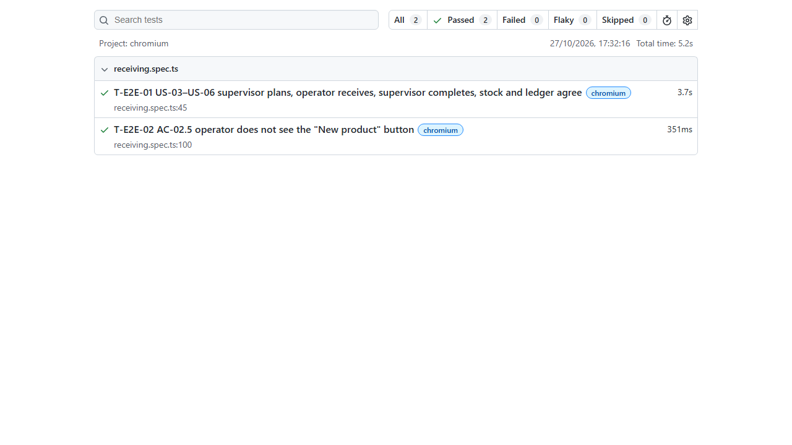

# Testing and Quality Assurance

| Field | Value |
|---|---|
| Strategy defined in | [technical-spec.md §9](technical-spec.md#9-testing-strategy) |
| Status | Strategy and catalogue written before implementation; evidence below is real command output from T014 and T023–T025. |

## 1. Approach

- **Test-first for business rules.** Each task in [tasks.md](tasks.md) lists its tests; the agent writes them before the implementation and must show them failing first.
- **Real database.** Integration tests run the real NestJS app against a real PostgreSQL database (`wrs_test`). Locks, transactions and CHECK constraints cannot be proven with mocks.
- **Traceable.** Every test name starts with the requirement it proves (`BR-07 …`, `AC-04.3 …`), so `npm test -- -t "BR-07"` finds the evidence for any rule.
- **Global invariant check.** After every receiving test, `assertInventoryConsistent()` verifies across the whole database that:
  - each product's on-hand quantity equals the sum of its inventory transactions and is never negative (BR-12);
  - each line's received quantity equals the sum of its unreversed receipts and stays between 0 and expected (BR-13).

## 2. How to run

| What | Command | Needs |
|---|---|---|
| Backend unit + integration | `cd backend && npm test` | `docker compose up -d db` and `backend/.env.test` (copy from `.env.test.example`) |
| One rule | `cd backend && npm test -- -t "BR-07"` | same |
| Concurrency stress (10 runs) | `cd backend && for i in $(seq 10); do npm test -- concurrency \|\| exit 1; done` | same |
| Coverage | `cd backend && npm test -- --coverage` | same |
| Frontend unit | `cd frontend && npm test` | — |
| End-to-end | `npm ci && npx playwright install chromium && npm run test:e2e` (repo root) | full stack running: `docker compose up --build -d`; demo passwords in `.env` |

## 3. Test catalogue

Levels: **U** unit, **I** integration/API (Supertest + PostgreSQL), **E** end-to-end (Playwright), **M** manual.

### 3.1 Critical business rules

| Test ID | Requirement | Level | Scenario | Expected |
|---|---|---|---|---|
| T-RCV-01 | AC-04.1, FR-31 | I | Receive 40 of 100 on an OPEN document | received 40, remaining 60, on-hand +40, 1 ledger row (+40, balance after 40), status IN_PROGRESS |
| T-RCV-02 | AC-04.2, FR-32 | I | Then receive the remaining 60 | received 100, fully received, on-hand 100 |
| T-RCV-03 | AC-04.3, BR-07 | I | Receive 61 with 60 remaining | 422 `QUANTITY_EXCEEDS_REMAINING`, `details.remainingQuantity = 60`; line, receipts, balance, ledger unchanged |
| T-RCV-04 | AC-04.4, BR-07 | I | Quantity 0, -1, 1.5, "ten", missing | 400 `VALIDATION_ERROR`; nothing changed |
| T-RCV-05 | AC-04.5, BR-08 | I | Receive on DRAFT, COMPLETED, CLOSED_SHORT, CANCELLED | 409 `INVALID_DOCUMENT_STATUS`; nothing changed |
| T-RCV-06 | BR-09 | I | Missing or malformed `Idempotency-Key` | 400 `VALIDATION_ERROR` |
| T-RCV-07 | — | I | Item ID that belongs to another document | 404 `NOT_FOUND` |
| T-IDM-01 | AC-04.6, BR-09 | I | Same request + key sent twice in sequence | 201 then 200 with same receipt id and `Idempotent-Replayed: true`; stock counted once |
| T-IDM-02 | AC-04.7, BR-09 | I | Same key, different quantity / different line | 409 `IDEMPOTENCY_KEY_REUSED`; nothing changed |
| T-IDM-03 | BR-09, spec §6 step 15 | I | Same request + key sent twice **in parallel** | exactly one receipt; one 201 and one 200 |
| T-CON-01 | AC-04.8, BR-14 | I | 5 parallel receipts of 4 against remaining 10 | exactly 2 × 201, 3 × 422; received 8; on-hand +8 |
| T-CON-02 | BR-12, BR-14 | I | 20 parallel receipts of 1 across 2 documents for the same product | on-hand +20 exactly; ledger has 20 rows; balances reconcile |
| T-CON-03 | BR-14 | I | Receipt and cancel in parallel on an OPEN document | exactly one succeeds; never "cancelled with stock received" |
| T-CON-04 | BR-14 | I | Last receipt and complete in parallel | complete succeeds only if it ran after the receipt; never "completed while not fully received" |
| T-CON-05 | AC-09.4, BR-19 | I | Two reversals of the same receipt in parallel | exactly one 200; one reversal row, one `RECEIPT_REVERSAL` ledger row |
| T-CON-06 | BR-13, BR-14 | I | Reversal and a new receipt on the same line in parallel | both serialize on the document lock; received and on-hand reconcile |
| T-INV-01 | AC-06.1 | I | Receipts 40 + 60 | inventory shows 100 |
| T-INV-02 | AC-06.2 | I | Transactions filtered by product | 2 rows, newest first, correct balance after, document number and user |
| T-INV-03 | AC-06.3, BR-12 | I | Reconciliation after every receiving test | Σ ledger = on-hand for every product |
| T-DB-01 | BR-13, NFR-01 | I | Direct SQL update setting received > expected | rejected by `ri_received_range_chk` |
| T-DB-02 | BR-12, NFR-01 | I | Direct SQL update setting a negative balance | rejected by `ib_non_negative_chk` |
| T-DB-03 | BR-19, NFR-01 | I | Direct SQL insert of a second reversal for the same receipt | rejected by the unique `receipt_id` |
| T-REV-01 | AC-09.1, FR-37 | I | Reverse the only receipt (100) | reversal stored; received 0; on-hand 0; ledger −100 / balance after 0; original receipt and RECEIPT row unchanged; status OPEN |
| T-REV-02 | AC-09.2 | I | Then receive 10 | received 10; IN_PROGRESS; ledger +100, −100, +10 |
| T-REV-03 | AC-09.3 | I | Receipts 40 + 60, reverse the 60 | received 40; on-hand −60; status stays IN_PROGRESS |
| T-REV-04 | AC-09.4, BR-19 | I | Reverse the same receipt twice | 409 `RECEIPT_ALREADY_REVERSED`; nothing changed |
| T-REV-05 | AC-09.5, BR-18 | I | Reverse on OPEN (after full reversal), COMPLETED, CLOSED_SHORT | 409 `INVALID_DOCUMENT_STATUS`; nothing changed |
| T-REV-06 | AC-09.6, BR-17, BR-18 | I | Receipt of another document; empty reason | 404; 400; nothing changed |
| T-REV-07 | AC-05.4, A-15 | I | Cancel after a full reversal moved the document to OPEN | CANCELLED; on-hand net 0 |

### 3.2 Documents, lines and status transitions

| Test ID | Requirement | Level | Scenario | Expected |
|---|---|---|---|---|
| T-STM-01 | BR-11, spec §7 | U | All 42 action × status combinations | allowed/denied and error code exactly per spec §7 |
| T-DOC-01 | AC-03.1, FR-22 | I | Create with 2 lines | DRAFT, number `RCV-YYYY-NNNNNN`, lines received 0 |
| T-DOC-02 | AC-03.2, BR-06 | I | Same product twice (on create and on add) | 409 `DUPLICATE_PRODUCT_IN_DOCUMENT` |
| T-DOC-03 | AC-03.3, BR-05 | I | Expected 0, -5, 2.5, 1,000,001 | 400 |
| T-DOC-04 | BR-04 | I | Missing supplier name, over-long fields | 400 with field names |
| T-DOC-05 | BR-16 | I | Unknown productId | 422 `PRODUCT_NOT_FOUND` |
| T-DOC-06 | BR-10 | I | Add/change/remove line on each non-DRAFT status | 409 `INVALID_DOCUMENT_STATUS` |
| T-DOC-07 | AC-03.4 | I | Open with no lines | 422 `DOCUMENT_HAS_NO_ITEMS` |
| T-DOC-08 | AC-03.5 | I | Open with lines | OPEN, opened_at/by set |
| T-DOC-09 | AC-05.1 | I | Complete when all received | COMPLETED; further receipts → 409 |
| T-DOC-10 | AC-05.2 | I | Complete with a line outstanding | 422 `ITEMS_NOT_FULLY_RECEIVED` with `incompleteItemIds` |
| T-DOC-11 | AC-05.3 | I | Complete DRAFT / OPEN | 409 `INVALID_STATUS_TRANSITION` |
| T-DOC-12 | AC-05.4, AC-05.5, BR-15 | I | Cancel DRAFT / OPEN; cancel IN_PROGRESS / COMPLETED / CLOSED_SHORT | CANCELLED with reason; 409 |
| T-DOC-13 | AC-05.6, BR-15 | I | Cancel without reason | 400 |
| T-CLS-01 | AC-08.1, FR-35 | I | Close short with 70 of 100 received | CLOSED_SHORT with reason/time/user; remaining 30; balance and ledger unchanged; receipt → 409 |
| T-CLS-02 | AC-08.2, BR-11 | I | Close short when every line is fully received | 422 `NOTHING_SHORT` |
| T-CLS-03 | AC-08.3 | I | Close short DRAFT / OPEN / COMPLETED / CLOSED_SHORT / CANCELLED | 409 `INVALID_STATUS_TRANSITION` |
| T-CLS-04 | AC-08.4, BR-17 | I | Close short with empty or 2-char reason | 400 |
| T-DOC-14 | FR-20 | I | List filtered by status, search by supplier and number, pagination meta | correct subsets and meta |

### 3.3 Products, auth and API behaviour

| Test ID | Requirement | Level | Scenario | Expected |
|---|---|---|---|---|
| T-PRD-01 | AC-02.1, FR-12 | I | Create `frz-chk-001` | stored as `FRZ-CHK-001`; balance row 0 |
| T-PRD-02 | AC-02.2, BR-02 | I | Create `frz-chk-001` again | 409 `DUPLICATE_SKU` |
| T-PRD-03 | AC-02.3, BR-01 | I | SKUs `AB`, `-ABC`, `AB C`, 51 chars | 400 naming `sku` |
| T-PRD-04 | AC-02.4 | I | Search `chk` | only matches, any case |
| T-AUT-01 | AC-01.1 | I | Valid login | token + user |
| T-AUT-02 | AC-01.2 | I | Wrong user / wrong password | identical 401 `INVALID_CREDENTIALS` bodies |
| T-AUT-03 | AC-01.3, FR-02 | I | No / malformed / expired token on a protected route | 401 `UNAUTHENTICATED` |
| T-AUT-04 | AC-01.4, AC-02.5, FR-03 | I | Operator calls each supervisor-only endpoint (create product, create document, line edits, open, complete, close short, cancel, reverse receipt) | 403 `FORBIDDEN`; nothing changed |
| T-API-01 | NFR-07 | I | Every path in `openapi.yaml` is routed; no undocumented routes | pass |
| T-API-02 | spec §4.2 | U | Exception filter maps AppError, validation, P2002, unknown errors | envelope shape and codes per spec §4.3 |
| T-HLT-01 | AC-07.1, AC-07.2 | I | DB up / DB query throws | 200 / 503 |

### 3.4 Frontend and end-to-end

| Test ID | Requirement | Level | Scenario | Expected |
|---|---|---|---|---|
| T-FE-01 | FR-04, spec §8 | U | `can(role, action)` table | matches the authorization matrix |
| T-FE-02 | AC-04.9, spec §6 | U | Receive form retry after network error | same idempotency key resent; new key after success |
| T-FE-03 | FR-04 | U | Document actions per role × status | only allowed buttons rendered |
| T-E2E-01 | US-03 → US-06 | E | Supervisor creates product + document, opens; operator receives partial then rest; supervisor completes; inventory and history correct | pass |
| T-E2E-02 | AC-02.5 | E | Operator does not see "New product" | pass |
| T-MAN-01 | NFR-06 | M | API error messages readable in UI; layout usable at 768 px | checklist below |

## 4. Evidence

> Filled in with real command output during implementation. Paste output, not summaries.

### 4.1 Full backend suite
Real `wrs_test` PostgreSQL database, no mocks of the database or Prisma.

```
$ cd backend && npm test -- --coverage
------------------------------------|---------|----------|---------|---------|-------------------
File                                | % Stmts | % Branch | % Funcs | % Lines | Uncovered Line #s
------------------------------------|---------|----------|---------|---------|-------------------
All files                           |   98.05 |    84.57 |   98.49 |   97.97 |
------------------------------------|---------|----------|---------|---------|-------------------
Test Suites: 19 passed, 19 total
Tests:       337 passed, 337 total

$ cd frontend && npm test
 Test Files  12 passed (12)
      Tests  65 passed (65)
```

### 4.2 Inventory stays correct after receiving (T-RCV-01, T-RCV-02, T-INV-01–03)
Each test also runs `assertInventoryConsistent()` afterwards: for every product, on-hand equals the sum of its ledger rows (BR-12), and every line's received quantity equals the sum of its non-reversed receipts (BR-13).

```
$ cd backend && npx jest test/receipts.spec.ts test/inventory.spec.ts test/reversal.spec.ts test/idempotency.spec.ts test/schema.spec.ts --json --outputFile=jest.json
# 71 passed, 0 failed; the lines below are this section's tests, taken from jest.json
✓ AC-04.1 FR-31 partial receipt updates line, stock, ledger and status atomically (389 ms)
✓ AC-04.2 FR-32 a second partial receipt fills the line (299 ms)
✓ BR-12 on-hand accumulates across documents for the same product (384 ms)
✓ AC-06.1 receipts of 40 and 60 show on-hand 100 (427 ms)
✓ AC-06.2 filtered by product: two RECEIPT rows newest first with document number and user (392 ms)
✓ AC-09.1 FR-37 reversing the only receipt zeroes line and stock, logs −100, and reopens the document (507 ms)
✓ AC-09.2 receiving again after a full reversal → IN_PROGRESS, ledger +100, −100, +10 (507 ms)
✓ AC-09.3 reversing one of two receipts keeps the other and stays IN_PROGRESS (403 ms)
```

The end-to-end run (§4.6) shows the same through the UI: receipts of 4 + 6 and 5 give on-hand 10 and 5, with three ledger rows for the document.

### 4.3 Duplicate and invalid operations do not corrupt stock (T-RCV-03–05, T-IDM-01–03)
"Nothing changes" in a test name means the test compares line, balance, ledger and receipt rows before and after the rejected call. The database tests insert by raw SQL, bypassing the API.

```
# Same run as §4.2 (71 passed, 0 failed); the lines below are this section's tests, taken from jest.json
✓ AC-04.3 BR-07 over-receipt → 422 with remaining, and nothing changes (334 ms)
✓ BR-07 a fully received line accepts nothing more (298 ms)
✓ BR-09 Idempotency-Key missing → 400 VALIDATION_ERROR, nothing changes (285 ms)
✓ BR-09 Idempotency-Key too short → 400 VALIDATION_ERROR, nothing changes (302 ms)
✓ BR-09 Idempotency-Key too long → 400 VALIDATION_ERROR, nothing changes (265 ms)
✓ BR-09 Idempotency-Key invalid characters → 400 VALIDATION_ERROR, nothing changes (266 ms)
✓ AC-04.6 FR-33 the same request twice → 200 replay with the same receipt, nothing changes (511 ms)
✓ AC-04.6 a replay returns the original receipt with the current line and stock (328 ms)
✓ AC-04.7 the same key with another quantity → 409 IDEMPOTENCY_KEY_REUSED, nothing changes (308 ms)
✓ AC-04.7 the same key with another line → 409 IDEMPOTENCY_KEY_REUSED, nothing changes (316 ms)
✓ AC-04.7 the same key on a line of another document → 409 (460 ms)
✓ BR-09 2 identical requests sent concurrently → one 201, the rest 200, one receipt (293 ms)
✓ BR-09 5 identical requests sent concurrently → one 201, the rest 200, one receipt (477 ms)
✓ BR-09 identical concurrent requests for the whole remaining quantity → one 201, the rest 200 (898 ms)
✓ BR-09 the same key sent concurrently with another quantity → one 201 and 409 IDEMPOTENCY_KEY_REUSED (718 ms)
✓ BR-09 the same key sent concurrently to lines of two documents → one 201 and 409, one receipt (948 ms)
✓ AC-04.6 a replay after the document was COMPLETED → 200 with the original receipt (377 ms)
✓ AC-09.4 BR-19 reversing the same receipt again → 409 RECEIPT_ALREADY_REVERSED, nothing changes (427 ms)
✓ AC-09.4 BR-19 two parallel reversals of the same receipt → exactly one 200 (1099 ms)
✓ AC-09.5 BR-18 OPEN after a full reversal → 409 INVALID_DOCUMENT_STATUS, nothing changes (496 ms)
✓ AC-09.5 BR-18 COMPLETED document → 409 INVALID_DOCUMENT_STATUS, nothing changes (301 ms)
✓ AC-09.5 BR-18 CLOSED_SHORT document → 409 INVALID_DOCUMENT_STATUS, nothing changes (344 ms)
✓ BR-13 BR-14 a reversal racing a receipt on the same line → both succeed, totals exact (1034 ms)
✓ BR-13 rejects received_quantity above expected_quantity at the database (21 ms)
✓ BR-12 rejects a negative balance at the database (4 ms)
✓ BR-19 rejects a second reversal for the same receipt at the database (5 ms)   # T-DB-03, separate run after it was added
```

### 4.4 Concurrency stress, 10 consecutive runs (T-CON-01–04)

`backend/test/concurrency.spec.ts`, real `wrs_test` database, all requests over HTTP against one listening server. The cancel and complete races repeat 5 rounds per run. `assertInventoryConsistent()` (BR-12, BR-13, AC-06.3) runs after every test.

```
$ cd backend && for i in $(seq 10); do echo "--- run $i"; npm test -- concurrency || exit 1; done
--- run 1
Tests:       4 passed, 4 total
--- run 2
Tests:       4 passed, 4 total
--- run 3
Tests:       4 passed, 4 total
--- run 4
Tests:       4 passed, 4 total
--- run 5
Tests:       4 passed, 4 total
--- run 6
Tests:       4 passed, 4 total
--- run 7
Tests:       4 passed, 4 total
--- run 8
Tests:       4 passed, 4 total
--- run 9
Tests:       4 passed, 4 total
--- run 10
Tests:       4 passed, 4 total

✓ AC-04.8 BR-14 5 parallel receipts of 4 against remaining 10 → exactly 2 succeed (435 ms)
✓ BR-12 BR-14 20 parallel receipts of 1 across two documents for the same product → totals exact (1014 ms)
✓ BR-14 receipt racing cancel on an OPEN document → exactly one wins (631 ms)
✓ BR-14 last receipt racing complete → never COMPLETED while a line is short (941 ms)
```

Control check: with `FOR UPDATE` removed from the document and line locks, the AC-04.8 test and the receipt-vs-cancel test fail (`2 failed, 2 passed`; the cancel race returned 500 from a CHECK violation). So these tests catch missing locks rather than passing by luck.

### 4.5 Clean-start deployment and health check (T023)
Fresh stack (new named volume), configuration taken unchanged from `.env.example`:

```
$ docker compose -p wrs-clean --env-file .env.example up --build -d --wait   # separate project = brand-new volume
 Container wrs-clean-db-1  Healthy
 Container wrs-clean-api-1  Healthy
 Container wrs-clean-web-1  Healthy

$ docker compose ps
NAME              STATUS                    PORTS
wrs-clean-api-1   Up 25 seconds (healthy)   3000/tcp
wrs-clean-db-1    Up 30 seconds (healthy)   127.0.0.1:5432->5432/tcp
wrs-clean-web-1   Up 19 seconds (healthy)   0.0.0.0:8080->80/tcp, [::]:8080->80/tcp

$ curl -fsS localhost:8080/health
{"status":"ok","database":"up"}

$ docker compose logs api        # first start
1 migration found in prisma/migrations
Applying migration `20261026134838_init`
All migrations have been successfully applied.
Seeded 2 users and 5 products
[NestApplication] Nest application successfully started

$ docker compose restart api && curl -fsS localhost:8080/health
{"status":"ok","database":"up"}

$ docker compose logs api        # after restart: migrations and seed re-run safely (NFR-05)
1 migration found in prisma/migrations
No pending migrations to apply.
Seeded 2 users and 5 products
[NestApplication] Nest application successfully started

$ curl -s -o /dev/null -w "%{http_code}\n" -d '{"username":"supervisor","password":"change-me"}' \
    -H 'Content-Type: application/json' localhost:8080/api/v1/auth/login
200
$ curl -s -o /dev/null -w "%{http_code} %{content_type}\n" localhost:8080/receiving/abc   # SPA fallback
200 text/html
$ docker exec wrs-clean-api-1 whoami
node
```

### 4.6 End-to-end run (T024)
`e2e/receiving.spec.ts` (Playwright, Chromium) against the Compose stack via nginx on `localhost:8080`. Fresh volume, then two consecutive runs; each run creates its own uniquely named products, so it can repeat on the same stack.

```
$ docker compose -p wrs-clean --env-file .env.example down -v && docker compose -p wrs-clean --env-file .env.example up -d --wait
$ for i in 1 2; do npm run test:e2e; done
=== run 1
  ✓  1 [chromium] › e2e
eceiving.spec.ts:45:5 › T-E2E-01 US-03–US-06 supervisor plans, operator receives, supervisor completes, stock and ledger agree (4.0s)
  ✓  2 [chromium] › e2e
eceiving.spec.ts:100:5 › T-E2E-02 AC-02.5 operator does not see the "New product" button (363ms)
  2 passed (5.4s)
=== run 2
  ✓  1 [chromium] › e2e
eceiving.spec.ts:45:5 › T-E2E-01 US-03–US-06 supervisor plans, operator receives, supervisor completes, stock and ledger agree (3.7s)
  ✓  2 [chromium] › e2e
eceiving.spec.ts:100:5 › T-E2E-02 AC-02.5 operator does not see the "New product" button (351ms)
  2 passed (5.2s)
```



### 4.6a README on a clean clone (T025)

Fresh `git clone` into a new folder (its own Compose project and volume), then the README's commands as written:

```
$ cp .env.example .env && docker compose up --build -d && docker compose ps
wrs-readme-check-api-1   Up 15 seconds (healthy)
wrs-readme-check-db-1    Up 20 seconds (healthy)
wrs-readme-check-web-1   Up 9 seconds (healthy)
$ curl localhost:8080/health
{"status":"ok","database":"up"}

# Running the tests
backend  (npm ci, npx prisma generate, cp .env.test.example .env.test, npm test)   Test Suites: 19 passed, 19 total / Tests: 337 passed, 337 total
frontend (npm ci, npm test)                                                         Test Files 12 passed (12) / Tests 65 passed (65)
e2e      (npm ci, npx playwright install chromium, npm run test:e2e)                2 passed (5.9s)

# Local development
$ npx prisma migrate dev     ->  Already in sync, no schema change or pending migration was found.
$ npx prisma db seed         ->  Seeded 2 users and 5 products
$ npm run start:dev          ->  {"status":"ok","database":"up"} from /health (run on PORT=3001: 3000 was taken by another dev server on this machine)
$ npm run dev (frontend)     ->  VITE ready
```

The first pass found one README gap: a fresh `npm ci` does not generate the Prisma client, so every backend suite failed with `Cannot read properties of undefined (reading 'SUPERVISOR')`. The `npx prisma generate` step was added and the run repeated.

### 4.7 Manual checklist (T-MAN-01)
- [ ] Operator sees no create/open/complete/cancel buttons
- [ ] Over-receipt attempt shows "only N remaining" message
- [ ] Double-clicking "Receive" records one receipt
- [ ] Expired session returns to login
- [ ] Pages usable at 768 px width

## 5. Known limitations and unresolved issues

| # | Limitation | Impact | Possible improvement |
|---|---|---|---|
| L-1 | No correction after `COMPLETED` or `CLOSED_SHORT` (PRD §5.2) | A miscount found after the document is closed cannot be fixed in the system | General stock adjustment feature with its own ledger type and approval |
| L-2 | Reversal is whole-receipt only (PRD A-14) | Fixing 100 → 10 takes two steps (reverse, then receive 10) | Acceptable; the two-step trail is clearer than an edit |
| L-3 | No lot / expiry / temperature capture (PRD Q-06) | Not sufficient for real cold-chain traceability | Add lot, production and expiry dates per receipt; FEFO reporting |
| L-4 | Single warehouse, no locations | Cannot say where stock is stored | Locations and putaway tasks |
| L-5 | Access token only, no refresh or revocation | Session ends after 8 h; a leaked token is valid until expiry | Refresh tokens with rotation, server-side revocation list |
| L-6 | Idempotency keys kept forever | `receipts.idempotency_key` grows with receipts (acceptable at this scale) | Scope keys per user and expire old ones |
| L-7 | Users only via seed | No onboarding of new staff | User management for supervisors/admins |
| L-8 | `JWT_EXPIRES_IN` is not validated at startup (found in the final repo audit) | A value without a unit such as `3600` is read as milliseconds (3-second tokens); a typo such as `eight` makes every login fail with 500 | Validate `^\d+[smhd]$` in `loadConfig`, like `PORT` |
| L-9 | Compose builds the API's database URL from `POSTGRES_PASSWORD` without URL-encoding | A password containing `@`, `/` or `:` breaks the connection | Keep the password URL-safe (README says so) or pass a full `DATABASE_URL` for the container |
| L-10 | Supplier name and unit of measure are stored as sent, not trimmed (decision T007/T009) | The API accepts a whitespace-only supplier name; the UI rejects it | Trim them like product name, if the business agrees |
| L-11 | Manual checklist §4.7 not yet signed off by a person | UI usability at 768 px and message readability are covered by unit tests and the E2E run only | Run the checklist on the Compose stack before the review |
